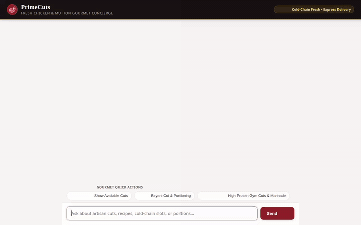

# PrimeCuts - Fresh Chicken & Mutton Gourmet Concierge

An agentic culinary butcher and fresh meat concierge built on **Google Cloud Agent Platform** with the **Agent Development Kit (ADK)** and `agents-cli`. PrimeCuts helps customers browse live inventory, select chef-recommended poultry and goat cuts, calculate portion sizes in a secure sandbox, view authentic recipes, and place orders with persistent cross-session memory.



> 💡 **Prefer a video player?** GitHub renders an interactive video player when a video is uploaded via its web editor. To display a video player rather than an inline looping GIF, drag [`agent_demo.webm`](agent_demo.webm) directly into the README editor on github.com.

---

## 🌟 Capabilities & Implemented Tools

Every feature below is implemented and wired to Google Cloud services in `app/`:

### 🧠 Cross-Session Long-Term Memory
- **Vertex AI Memory Bank**: Configured with `PreloadMemoryTool` and `add_session_to_memory` in `after_agent_callback`. Remembers customer dietary restrictions, past cuts, and allergies (e.g., dairy, gluten, nuts, specific spices) across independent chat sessions.

### 🗄️ Database & Inventory (Firestore)
- **Google Cloud Firestore**: Reads live inventory, stock levels, and temperature compliance standards (`firestore_list_cuts`, `firestore_get_cut_details`).
- **Customer Profiles**: Persists dietary goals, spice tolerances, and delivery preferences into Firestore (`firestore_save_customer_preferences`, `firestore_get_customer_preferences`).

### 🪟 Agent-to-User Interface (A2UI)
- Emits structured A2UI v0.8 cards (`Card`, `Column`, `Row`, `Text`, and `Image`) parsed via `a2ui_callback` in `after_model_callback`.
- Natively rendered in both the ADK dev UI and the custom web frontend for visual menus and dish summaries.

### 🖼️ Media Generation & Public Cloud Storage
- **Google Cloud Storage**: Public bucket hosting culinary plating graphics and video assets.
- **Plating Visual Generator**: Generates culinary plating presentation visuals and stores them directly to Cloud Storage (`generate_recipe_plating_visual`).
- **Omni Model Video Showcase**: Generates short showcase videos using Google's Omni model (`gemini-omni-flash-preview` on Vertex AI in the global region) via `generate_cut_showcase_video`. Saves the video session artifact with ADK `tool_context.save_artifact` and uploads it to Cloud Storage for public access.

### 🧪 Secure Code Sandbox
- **Agent Engine Sandbox**: Safely executes Python code in a dedicated `AgentEngineSandboxCodeExecutor` on Vertex AI for precise nutritional macro calculations, marinade ingredient ratios, and weight-based cooking times.

### 🗺️ Location & Recipe Grounding
- **Google Maps Platform**: Geocodes delivery addresses and discovers nearby distribution hubs (`geocode_address`, `find_nearby_places`).
- **Authentic Culinary Recipes**: Queries authentic recipe steps and ingredient measurements (`lookup_authentic_recipe`).

---

## 📋 Implementation Status

| Feature / Tool | Status | Backed By |
|---|---|---|
| **Memory Bank Recall** | ✅ Implemented | Vertex AI Memory Bank (`PreloadMemoryTool`) |
| **Catalog & Inventory** | ✅ Implemented | Cloud Firestore (`firestore_list_cuts`) |
| **Customer Preferences** | ✅ Implemented | Cloud Firestore (`customer_preferences`) |
| **Order Management** | ✅ Implemented | ADK Meat Tools (`place_meat_order`, `track_order_status`) |
| **A2UI Rich UI Cards** | ✅ Implemented | ADK Callback + A2UI v0.8 Catalog |
| **Plating Visuals** | ✅ Implemented | Cloud Storage Bucket + Plating Generator |
| **Showcase Videos** | ✅ Implemented | `gemini-omni-flash-preview` (Vertex AI Omni) |
| **Code Execution Sandbox**| ✅ Implemented | Vertex AI `AgentEngineSandboxCodeExecutor` |
| **Address Geocoding** | ✅ Implemented | Google Maps API |
| **Recipe Grounding** | ✅ Implemented | Authentic Culinary Recipe API |
| **Live Delivery Route Mapping** | ⏳ *Planned, not yet implemented* | Real-time GPS driver tracking |

---

## 🏗️ Architecture

```
┌────────────────────────────────────────────────────────┐
│                   Web Browser / Client                 │
└───────────────────────────┬────────────────────────────┘
                            │ HTTP / JSON
                            ▼
┌────────────────────────────────────────────────────────┐
│             FastAPI Proxy (Cloud Run / Local)          │
│  - Serves static chat UI & A2UI card renderer          │
│  - Authenticates via Application Default Credentials   │
└───────────────────────────┬────────────────────────────┘
                            │ A2A Protocol
                            ▼
┌────────────────────────────────────────────────────────┐
│        ADK Agent Runtime (Vertex AI Reasoning Engine)   │
│  - Gemini 2.5 Flash (`root_agent`)                     │
│  - Cross-Session Memory Bank Callback                  │
│  - A2UI Post-Model Callback                            │
└─────────────┬───────────────────────────┬──────────────┘
              │                           │
              ▼                           ▼
┌───────────────────────────┐ ┌──────────────────────────┐
│      Data & Storage       │ │      External Tools      │
│ - Cloud Firestore         │ │ - Omni Video Generation  │
│ - Cloud Storage Bucket    │ │ - Code Sandbox Execution │
│ - Vertex AI Memory Bank   │ │ - Google Maps Geocoding  │
└───────────────────────────┘ └──────────────────────────┘
```

---

## 🚀 Running Locally

### Prerequisites
- Python 3.11+
- [uv](https://docs.astral.sh/uv/) package manager
- Google Cloud CLI (`gcloud`) authenticated to your Google Cloud project

### 1. Set Up the Agent Backend
Navigate to the agent directory and install dependencies:

```bash
cd primecuts-concierge
uv sync
```

Set up your environment variables in `.env`:

```bash
cp .env.example .env
# Edit .env with your GCP project ID and credentials
```

Seed the Firestore database with sample fresh poultry and mutton cuts:

```bash
python seed_firestore.py
```

Run the interactive local playground:

```bash
agents-cli playground
```

### 2. Run the Web Frontend & A2A Proxy

In a separate terminal, install the frontend dependencies and launch the FastAPI proxy server:

```bash
cd primecuts-concierge/frontend
pip install -r requirements.txt

export AGENT_ENGINE_RESOURCE_NAME="projects/<PROJECT_NUMBER>/locations/<REGION>/reasoningEngines/<ENGINE_ID>"
export AGENT_DIRECTORY="app"
export PORT=8080

python main.py
```

The web interface will be available at port 8080.
